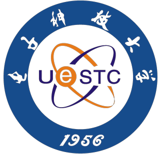

My name is Yanming Yang. I am a **first-year Ph.D. student** at the [AGI Lab](https://github.com/Westlake-AGI-Lab), [Westlake University](https://en.westlake.edu.cn), advised by Professor [Chi Zhang](https://icoz69.github.io).

# Research Interests

My research focuses on 3D Reconstruction and World Models.

# Publications

Please visit my [Google Scholar profile]({{ site.author.googlescholar }}) for my publications.

# Education

  

    
  

  

    
M.Sc. in Computer Graphics, Vision and Imaging

    
University College London Tutor: <a href="https://scholar.google.com/citations?user=IRMX4-4AAAAJ&amp;hl=en">Prof. Lourdes Agapito</a>

  

  
2023 &ndash; 2024

  

    
  

  

    
B.Eng. in Communication Engineering

    
University of Electronic Science and Technology of China

  

  
2019 &ndash; 2023

# Experience

  

    
  

  

    
Research Assistant

    
AGI Lab, Westlake University Advisor: <a href="https://icoz69.github.io">Prof. Chi Zhang</a>

  

  
Oct 2024 &ndash; Aug 2026

